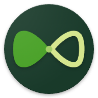
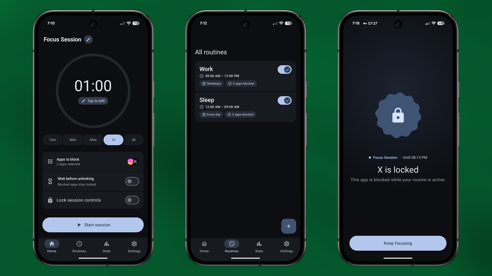
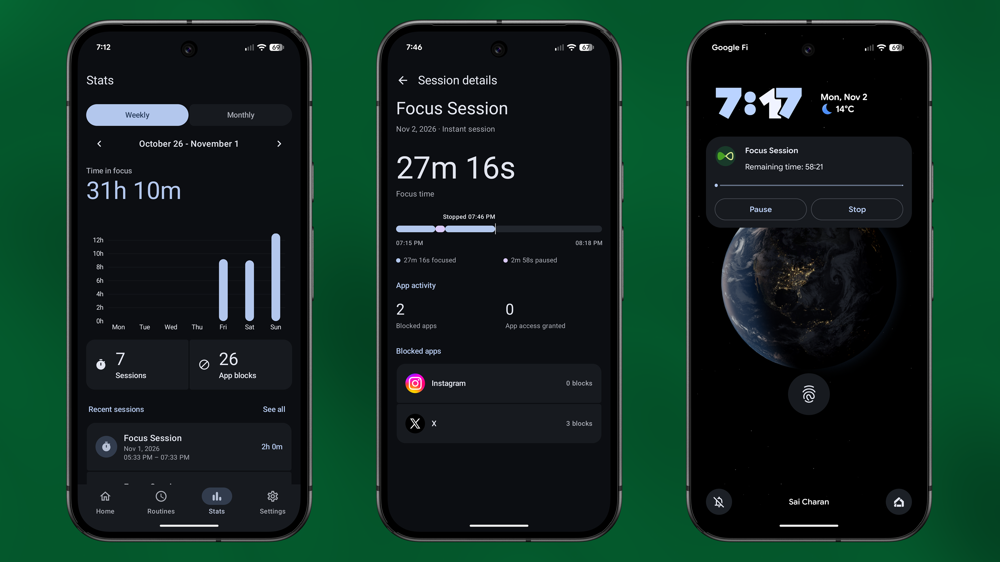

  

# Unloop

Unloop is an Android app that helps you reduce distractions by blocking selected apps during scheduled routines and instant focus sessions.

  

  

## Routines

Routines let you set aside time for focus throughout the week.

- Choose the apps you want to block.
- Set start and end times and select the days your routine repeats.
- Enable or disable routines as your schedule changes.

## Instant sessions

Start a focus session whenever you need one.

- Choose a preset duration or set your own.
- Give your session a name and select the apps to block.
- Track the remaining time, pause, resume, or end the session when session controls are unlocked.

## Focus rules

Choose how you can access blocked apps and control each session.

- Allow temporary app access by holding the unlock button for a configurable wait time.
- Use strict mode to keep blocked apps locked for the session.
- Lock session controls to prevent pausing or ending a session early.

## Statistics

Look back at your focus time and app activity.

- View weekly and monthly focus charts, session counts, and app block counts.
- Browse session history for a selected date range.
- Open a session to see focus and pause times, a focus timeline, and app activity.
- View block and access grant counts for each app over a selected date range.

## Features

- Scheduled routines and instant focus sessions
- App blocking with configurable unlock rules
- Optional session control locking
- Focus statistics and session history
- Light, dark, and system themes with optional dynamic colors
- Material Design 3 Expressive UI

## Tech stack

- Kotlin
- Jetpack Compose and Material 3 Expressive
- Room Database
- DataStore
- Hilt
- Navigation 3
- Vico charts
- MVI architecture

## Build and run

1. Open the project in Android Studio with support for the Android Gradle Plugin version in `gradle/libs.versions.toml`.
2. Use JDK 21, as configured in CI, and install Android SDK Platform 37.
3. Add your Firebase `google-services.json` for the debug application ID, `com.charan.unloop.debug`, to `app/src/debug/`.
4. Sync Gradle and run the `app` debug configuration on a device running Android 8.0 or later.

You can also build the debug APK with `./gradlew :app:assembleDebug`.

On first launch, onboarding guides you through notification, usage access, and display over other apps permissions. Unloop uses usage access to detect blocked apps and an overlay to show the blocking screen.

## License

Unloop is available under the [MIT License](LICENSE).
